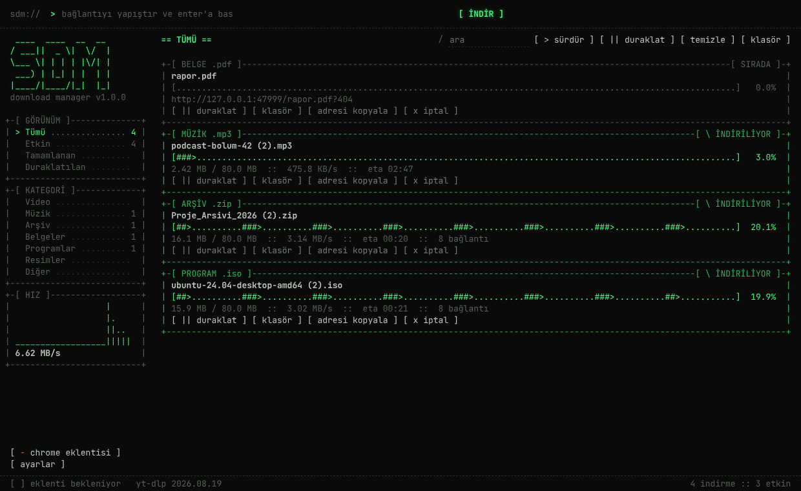

# SDM — İndirme Yöneticisi

IDM (Internet Download Manager) benzeri, çok parçalı indirme yapan, Chrome'dan indirmeleri ve
videoları otomatik yakalayan, ASCII / terminal görünümlü bir masaüstü uygulaması.



## Ne yapar

| Özellik | Nasıl |
|---|---|
| **Hızlandırılmış indirme** | Dosya 8 parçaya bölünür, her parça ayrı bağlantıyla iner (ayarlanabilir, 1–32). Bir parça bitince en yavaş parçanın kalanı ikiye bölünüp boşalan bağlantıya verilir (dinamik bölme — IDM'in hızının asıl sırrı). İlerleme çubuğunda her bağlantı ayrı görünür: `[###>.....###>.....###>....]` |
| **Duraklat / sürdür** | Uygulama kapansa, bilgisayar yeniden başlasa bile kaldığı yerden devam eder. Sunucudaki dosya değiştiyse (`If-Range`) bozuk dosya üretmek yerine baştan indirir. |
| **Chrome'dan otomatik yakalama** | Eklenti, Chrome'un başlattığı indirmeyi iptal edip çerezler ve Referer ile birlikte SDM'ye verir; giriş gerektiren sitelerden indirme de çalışır. SDM kapalıysa hiçbir şeye dokunmaz, Chrome normal indirir. |
| **Video yakalama** | Video oynatıcıların üstünde `[ v SDM ile indir ]` düğmesi çıkar. YouTube, Vimeo, X, Instagram, TikTok, Facebook, Twitch dahil ~1800 site [yt-dlp](https://github.com/yt-dlp/yt-dlp) ile; diğer sitelerde eklentinin ağ trafiğinden yakaladığı m3u8 / mpd / mp4 akışlarıyla. Kalite seçimi (en iyi / 1080 / 720 / 480 / sadece ses mp3). |
| **Düzen** | Dosyalar `İndirilenler/SDM/Video`, `Müzik`, `Arşiv`, `Belgeler`, `Programlar`… klasörlerine ayrılır. Aynı ad varsa üzerine yazmaz, `(1)` ekler. |
| **Diğer** | Ortak hız sınırı, aynı anda indirme sınırı, sistem tepsisi, açılışta başlatma, tamamlanınca bildirim, panodan yapıştırınca indirme. |

## Her bilgisayara kurulum

### 1) Uygulama

[Releases](../../releases) sayfasından işletim sistemine uygun dosyayı indir:

- **Windows:** `SDM-Kurulum-x.y.z.exe`
- **macOS:** `.dmg`
- **Linux:** `.AppImage` veya `.deb`

> **Windows "bilgisayarınız korundu" uyarısı verirse:** *Ek bilgi → Yine de çalıştır*.
> Kurulum dosyası dijital olarak imzalı değil. Bu uyarıyı kaldırmanın tek yolu ücretli bir kod
> imzalama sertifikası almak. macOS'ta ilk açılışta *sağ tık → Aç* gerekir.

Yeni bir sürüm yayımlamak için: `git tag v1.0.1 && git push --tags`. GitHub Actions üç
işletim sistemi için kurulum dosyalarını üretir ve taslak sürüme yükler.

### 2) Chrome eklentisi (bilgisayar başına bir kez)

1. Chrome'da `chrome://extensions` aç.
2. Sağ üstten **Geliştirici modu**'nu aç.
3. **Paketlenmemiş öğe yükle** → SDM'nin kurulum klasöründeki `extension` klasörünü seç.
   (Uygulamada `[ chrome eklentisi ]` → `[ aç ]` bu klasörü doğrudan açar.)
4. Eklenti simgesinde `OFF` yazısı kaybolduysa bağlantı tamam.

Edge, Brave, Opera ve Vivaldi'de de aynı adımlar geçerli.

> Tek tıkla kurulum için eklentinin Chrome Web Mağazası'na yüklenmesi gerekir (bir kerelik
> 5 $ geliştirici kaydı + Google incelemesi). Chrome, mağaza dışındaki eklentilerin sessizce
> kurulmasına izin vermez.

## Sınırlar

- **DRM'li içerik indirilemez:** Netflix, Disney+, Prime Video, Spotify, BluTV ve benzerleri
  şifreli akış kullanır. Bu bir eksik değil, bilinçli bir sınırdır.
- **YouTube ve benzerleri** sık değişir. yt-dlp ilk videoda otomatik iner ve haftada bir kendini
  günceller. Bir site bozulursa *Ayarlar → yt-dlp → güncelle* çoğu zaman çözer.
- Tek kullanımlık bağlantılar (POST form ile başlayan ya da imzası bir kez geçerli indirmeler)
  yeniden istenemeyebilir. Bu durumda eklentiyi o site için kapatıp *hariç tutulan siteler*e
  ekleyebilirsin.
- Telif hakkıyla korunan içeriği indirmek sitenin kullanım şartlarına aykırı olabilir;
  sorumluluk kullanıcıdadır.

## Geliştirme

```bash
npm install
npm start          # uygulamayı çalıştır
npm test           # indirme motoru + köprü testleri
npm run dist:win   # Windows kurulum dosyası (dist/)
npm run icons      # simgeleri yeniden üret (Python + Pillow)
```

### Mimari

```
Chrome ── eklenti (extension/) ──HTTP 127.0.0.1:47321──▶ src/main/bridge.js
                                                            │
src/renderer/ (ASCII arayüz) ◀──IPC──▶ src/main/main.js ────┤
                                                            ▼
                                   src/main/engine.js  (çok parçalı HTTP motoru, kuyruk, kalıcılık)
                                   src/main/video.js   (yt-dlp + ffmpeg)
```

- **Köprü güvenliği:** Yerel sunucu yalnızca `127.0.0.1`'de dinler. İndirme başlatan istekler
  sadece `Origin: chrome-extension://…` taşıyorsa kabul edilir. Tarayıcılar web sitelerinin bu
  başlığı taklit etmesine izin vermez; böylece herhangi bir web sitesi bilgisayarına indirme
  başlatamaz.
- **Neden native messaging değil:** Native messaging her bilgisayarda eklenti kimliğini kayıt
  defterine yazmayı gerektirir. Paketlenmemiş eklentinin kimliği ise kurulduğu yere göre değişir.
  Yerel HTTP köprüsü kurulumdan sonra ek ayar istemez.

Font: [JetBrains Mono](https://github.com/JetBrains/JetBrainsMono) (SIL OFL 1.1) uygulamaya
gömülüdür, her bilgisayarda ASCII hizası aynı kalır.
